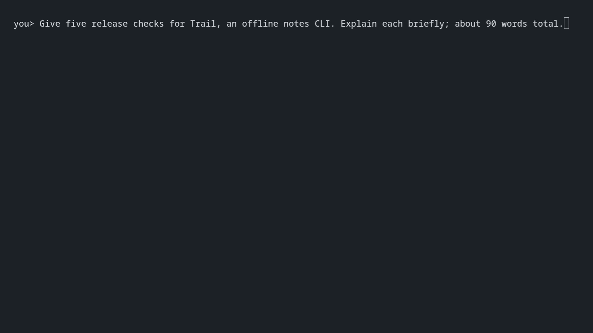

<p align="center">
  <picture>
    <source media="(prefers-color-scheme: dark)" srcset="assets/xenolith-paper.svg">
    
  </picture>
</p>

<p align="center"><strong>Local inference for Intel integrated GPUs.</strong></p>

<p align="center">
  <a href="https://xenolith.it">Website</a> ·
  <a href="#quick-start">Quick start</a> ·
  <a href="docs/README.md">Documentation</a> ·
  <a href="#gpu-compatibility">GPU compatibility</a> ·
  <a href="CONTRIBUTING.md">Contributing</a>
</p>

## About

Xenolith is a pure C inference engine for Intel integrated GPUs on Linux, currently focused on Gemma 4 26B-A4B QAT.

This project exists because I need it. I want to extract the most I can from my laptop: an HP Envy 17 with an i7-13700H and 32 GB of dual-channel DDR4-3200 RAM. Systems like mine are very common, and I find them interesting because the CPU and GPU share memory, but have a very limited memory bandwidth.

I’m building Xenolith for single-machine, single-user inference. I’m not trying to support every model and every backend; I want to make this particular kind of setup useful for everyday local work.

Most of the testing and optimization happens on the hardware I have. Occasionally I can also use machines provided through Intel’s cloud, as I did with Panther Lake. Other supported Intel integrated GPUs are listed in the [GPU compatibility matrix](#gpu-compatibility), which distinguishes tested and untested devices.

## Quick start

```sh
curl -fsSL https://xenolith.it/install.sh | sh
```

Setup checks the GPU, configures a model and opens chat or the selected client.
Run `xenolith chat` for later sessions.

<picture>
  <source media="(prefers-reduced-motion: reduce)" srcset="assets/xenolith-three-clients-v2-poster.png">
  
</picture>

## Why should you use Xenolith
If you have the target spec, Xenolith could be interesting because it is specifically designed to take the most out of this hardware.
In fact, I noticed that general engines like llama.cpp (honestly, the only one I tried) has this problem: either you run it on the CPU or on the GPU. I mean, there are some options that enable to offload some layer to one and some to the other, but that's not the point. The thing is that it makes more sense to separate the two based on the two phases: prefill and decode.
We know that prefill is mostly compute-bound and decode is bandwidth-bound, so it makes sense to exploit the GPU parallelization during the prefill and use CPU during decode. Why don't use GPU also for decode? Because, for some reason, on this hardware CPU can exploit more bandwidth.
So Xenolith is built to do exactly that, and we can see some non-extraordinary results in the benchmarks:

| Token/s | Xenolith | llama.cpp CPU | llama.cpp Vulkan |
|---|---:|---:|---:|
| pp512 | **204,27** | 70,59 | 189,07 |
| pp2048 | **171,08** | 51,11 | 160,67 |
| tg128 | **18,39** | 14,66 | 11,96 |

These are medians of three measurements per row on the target laptop. The llama.cpp CPU column uses one profile throughout: six generation threads, twenty batch threads, CPUs 0–19, mmap, and no BLAS. The input is the same fixed synthetic token sequence for all engines; `tg128` starts from an empty context. The measured samples and instructions for checking or repeating the comparison are in [bench/compare_pp_tg.md](bench/compare_pp_tg.md). Results from a new run can vary with system conditions.

So you can see that, while with llama.cpp you have to choose which one to prioritize between prefill and decode, with Xenolith you have a more balanced setup.

Again, if you look at the decode and prefill improvements separately, you can see that there is no incredible jump, but if you look combined, it can be very useful for a better local experience on this limited hardware.

I want to specify that I didn't write the kernels myself, but I used a mix of Fable and Sol to autoresearch and autoimprove them.

## GPU compatibility

Xenolith targets Intel integrated GPUs based on the Xe architecture, on Linux using Level Zero (`intel-compute-runtime`). Compatibility is tracked by GPU device ID. Discrete GPUs are not enabled.

- **Tested:** a successful Xenolith run has been reported on a system with this device ID. This does not imply validation on every system or driver version.
- **Untested:** enabled based on expected compatibility, but a successful Xenolith run has not yet been reported. The engine prints a notice and continues initialization.

All IDs below are hexadecimal and use Intel vendor ID `8086`. IDs not listed are not enabled. A compatible driver and sufficient system memory are required. All enabled devices currently use the existing kernels without XMX acceleration.

| GPU platform | GPU architecture | Tested device IDs | Untested device IDs |
|---|---|---|---|
| **Tiger Lake** | Xe-LP | — | `9a40`, `9a49`, `9a59`, `9a60`, `9a68`, `9a70`, `9a78` |
| **Rocket Lake** | Xe-LP | — | `4c80`, `4c8a`, `4c8b`, `4c8c`, `4c90`, `4c9a` |
| **Alder Lake mobile** | Xe-LP | — | `4626`, `4628`, `462a`, `46a0`, `46a1`, `46a3`, `46a6`, `46a8`, `46aa`, `46b0`, `46b1`, `46b3`, `46c0`, `46c1`, `46c3` |
| **Alder Lake desktop** | Xe-LP | — | `4680`, `4682`, `4688`, `468a`, `468b`, `4690`, `4692`, `4693` |
| **Alder Lake-N / Twin Lake** | Xe-LP | — | `46d0`, `46d1`, `46d2`, `46d3`, `46d4` |
| **Raptor Lake mobile / refresh** | Xe-LP | `a7a0` | `a720`, `a721`, `a7a1`, `a7a8`, `a7a9`, `a7aa`, `a7ab`, `a7ac`, `a7ad` |
| **Raptor Lake desktop / refresh** | Xe-LP | — | `a780`, `a781`, `a782`, `a783`, `a788`, `a789`, `a78a`, `a78b` |
| **Meteor Lake** | Xe-LPG | — | `7d40`, `7d45`, `7d55`, `7dd5` |
| **Arrow Lake** | Xe-LPG / Xe-LPG+ | `7d51` | `7d41`, `7d67`, `7dd1` |
| **Lunar Lake** | Xe2 | `64a0` | `6420`, `64b0` |
| **Panther Lake** | Xe3 | `b080` | `b081`, `b082`, `b083`, `b084`, `b085`, `b086`, `b087`, `b08f`, `b090`, `b0a0`, `b0b0` |
| **Wildcat Lake** | Xe3 | — | `fd80`, `fd81` |
| **Nova Lake (Xe3 GPU)** | Xe3 | — | `d740`, `d741`, `d742`, `d743`, `d744`, `d745` |
| **Nova Lake (Xe3P GPU)** | Xe3P | — | `d74a`, `d74b`, `d750`, `d751`, `d752`, `d753`, `d754`, `d755`, `d756`, `d757`, `d75f` |

Device IDs are based on [Intel Compute Runtime](https://github.com/intel/compute-runtime/blob/master/shared/source/dll/devices/devices_base.inl), with platform names cross-checked against Intel's [i915](https://dgpu-docs.intel.com/overview/supported-hardware/i915-driver-gpus.html) and [Xe](https://dgpu-docs.intel.com/overview/supported-hardware/xe-driver-gpus.html) hardware tables and the [Linux PCI ID definitions](https://github.com/torvalds/linux/blob/master/include/drm/intel/pciids.h). Tested status refers to Xenolith runs, not Intel's driver support status.

Tested configurations:

| GPU device ID | Processor / GPU | Test source |
|---|---|---|
| `8086:a7a0` | Core i7-13700H / Iris Xe, 32 GB RAM | Maintainer's HP Envy 17; [benchmark results](bench/compare_pp_tg.md) |
| `8086:7d51` | Core Ultra 7 255H / Arc 140T | [aziis98's report in PR #2](https://github.com/simoneiacomino/xenolith/pull/2) |
| `8086:64a0` | Core Ultra 7 268V / Arc 140V, 32 GB RAM | [raffaeleedidonna's report in PR #6](https://github.com/simoneiacomino/xenolith/pull/6); Windows 11, Ubuntu 24.04 under WSL2 |
| `8086:b080` | Core Ultra X7 358H / Arc B390 | [CPU worker measurements with full-model prefill](bench/cpu-workers.md) |

If inference works on an untested device, please [open an issue](https://github.com/simoneiacomino/xenolith/issues) or submit a PR with your results so its ID can be marked tested in both the code and this table. If it fails, please open an issue describing the problem. Include the GPU device ID, processor, RAM, OS (including WSL if applicable), driver/runtime versions, Xenolith commit, model, command and relevant output. Device detection alone is not an inference test.

## Design choices
First of all, I decided to not implement an internal agent/harness because that's another whole piece of software that needs attention and care. Also, harnesses are the new IDEs, so very personal, and everyone should use the one he prefers.

So now we need a way to connect your harness to Xenolith. The standard way is a stateless chat/completions HTTP server that was designed to handle massive multi-user requests to a central server. This is a totally different use case than the one we are handling: single-machine, single-user inference.
I thought that, in this context, it would be better to create a [stateful protocol](docs/protocol.md) so that the harness could talk to the engine in a session-aware way like an integrated agent would.
So now we don't have to send all the history, but we can just "append" the user message. Also, we can make the harness aware of such thing that are valuable in local inference, like the progress of a prefill or the cost of a rewind.

But this currently means that you have to fork your harness and make it talk the Xenolith protocol or write an adapter like I did.
In fact, I also made [Xenopi](https://github.com/simoneiacomino/xenopi), a pi distribution that ships an adapter with pi that translates its requests to Xenolith protocol. This is just a simple example I did to test the engine and the protocol.

There is also [CodeXe](https://github.com/crrisci/codexe), a community-maintained fork of Codex with native Xenolith protocol support, persistent sessions and vision.

## Limits
Current observed limits are right now in the prefill kernel that doesn't scale as well as the Vulkan one. In fact, we can start see a regression in pp8192 where Vulkan becomes faster. But nothing that isn't improvable by spending some tokens on it.

## Build from source

On Arch install the build tools, Level Zero, and Intel's GPU runtime:

```sh
sudo pacman -S --needed gcc make binutils coreutils level-zero-headers level-zero-loader intel-compute-runtime
```

Clone Xenolith, then build it and configure it with Unsloth's [Gemma 4 26B-A4B IT QAT UD-Q4_K_XL GGUF](https://huggingface.co/unsloth/gemma-4-26B-A4B-it-qat-GGUF/blob/main/gemma-4-26B-A4B-it-qat-UD-Q4_K_XL.gguf):

```sh
git clone https://github.com/simoneiacomino/xenolith.git
cd xenolith
make
./xenolith config init --model /absolute/path/gemma-4-26B-A4B-it-qat-UD-Q4_K_XL.gguf --ctx 65536
./xenolith chat
```

To install the built command for your user:

```sh
make install
```

See the [source build guide](docs/build.md) for dependencies, install prefixes and staging.

## Thought and response prefixes

Clients can supply the opening text of Gemma's thought channel through
`reasoning.prefix` in the wire protocol. Xenolith prefills the text before
sampling its continuation, retaining its provenance across sessions and replay.
See [the protocol](docs/protocol.md#reasoning-prefixes) for capability detection,
limits and accounting. With thinking disabled, `response.prefix` supplies the
opening text of the visible answer instead. The companion Xenopi command
`/lobotomy` selects the appropriate channel from the current thinking setting.

## Experimental activation steering

Generate steering vectors locally from the same Gemma QAT GGUF used for
inference, then load one with `run` or `chat --steering FILE`. `wire` and `serve`
can expose registered artifacts and per-session changes through
`--steering-dir DIR`. Existing cache effects are retained across changes.
See [the steering guide](STEERING.md) for extraction, modes, provenance,
durable-session behavior, and evaluation status.
The bundled succinctness experiment did not yield a validated production setting.
See the [English/Italian pilot](steering/LANGUAGE_EVALUATION.md) for a separate
language-steering experiment and its interactive launcher.

The [ds4-style verbosity follow-up](steering/VERBOSITY_EVALUATION.md) uses
locally extracted FFN directions and demonstrates shorter validation answers,
with documented information loss and formatting limitations.

## Documentation

See the [documentation index](docs/README.md) for CLI usage, C integration,
vision, tuning and tests.

## Acknowledgments

Thanks to:

- [Raffaele](https://github.com/raffaeleedidonna), for helping build and maintain Xenolith.
- [Francesco](https://github.com/crrisci), for his work on [CodeXe](https://github.com/crrisci/codexe).
- [@aziis98](https://github.com/aziis98) and [@madduci](https://github.com/madduci), for being the first to try Xenolith on machines other than mine.

This project was inspired by [antirez’s DwarfStar](https://github.com/antirez/ds4). [llama.cpp](https://github.com/ggml-org/llama.cpp) has also been a useful reference throughout its development.
